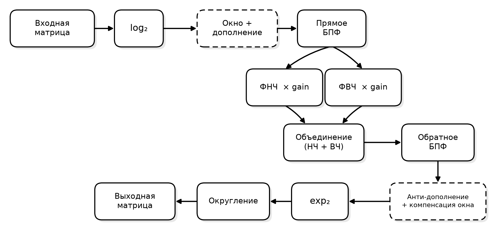
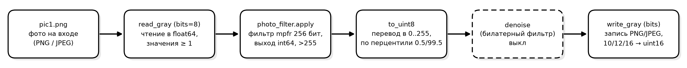
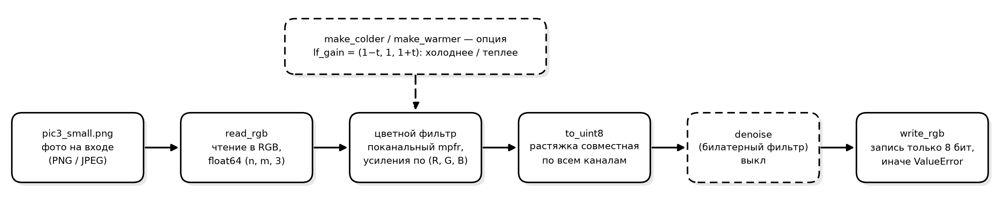
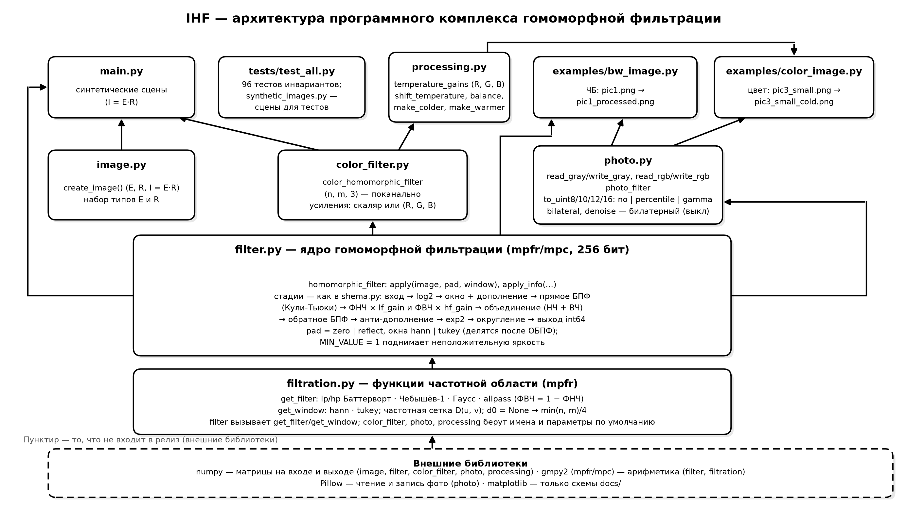

# IHF-IMAGE-HOMOMORPHIC-FILTER

**Русский** / [English](README_EN.md)

## Гомоморфная фильтрация изображений в арифметике произвольной точности

**Версия:** 0.80

**Базовая модель:** `I = E·R` → `log₂` → F → разделение спектра на НЧ и ВЧ → обработка частей → соединение → F^-1 → `exp₂` → округление.

**Реализовано:** базовая модель, обработка в оттенках серого и цветных фотографий,
96 тестов и частично документация.



## Установка

```bash
python -m venv .venv && pip install -r requirements.txt
```

Подробности, активация окружения под Windows/Linux/macOS и системные
зависимости (`libgmp`, `libmpfr`, `libmpc`) — в [INSTALL.md](INSTALL.md).

Запуск:

```bash
python main.py                      # тесты фильтра
python examples/bw_image.py         # Фотография в оттенках серого
python examples/color_image.py      # цветная фотография
```

## Использование

### Матрица синтетического изображения

```python
from image import create_image
from filter import homomorphic_filter

# E — освещённость (int 1..255), R — коэффициент отражения (float (R_MIN, 1]), I = E*R
e, r, i = create_image("const", "chess", 64, 64)

# Ослабление НЧ и усиление ВЧ
f = homomorphic_filter(lf_gain=0.5, hf_gain=2.0)
filtered = f.apply(i)
```

### Фотография в оттенках серого

```python
from photo import photo_filter, read_gray, write_gray

photo = read_gray("examples/pic1.png")               # float64 (n, m), значения > 0
f = photo_filter(lf_gain=0.75, hf_gain=2.0, d0=30.0) # pad="reflect" по умолчанию
write_gray("out.png", f.to_uint8(f.apply(photo)))
```

### Цветная фотография

Каналы обрабатываются раздельно.

```python
from photo import photo_filter, read_rgb, write_rgb
from color_filter import color_homomorphic_filter

photo = read_rgb("examples/pic3_small.png")  # float64 (n, m, 3), RGB, альфа отбрасывается

# Усиления можно задавать по каналам: скаляр или (R, G, B)
f = color_homomorphic_filter(lf_gain=(0.99, 1.0, 1.01), hf_gain=1.0, pad="reflect")
write_rgb("out.png", photo_filter.to_uint8(f.apply(photo)))
```

`lf_gain` по каналам меняет **освещённость** (цвет света), `hf_gain` —
**коэффициент отражения** (детали), согласно модели `I = E·R`:
в логарифмах низкие частоты — это `E`, высокие — `R`.

«Холоднее» (colder): `(0.99, 1.0, 1.01)`.

### Перевод в N бит (`to_uint8`, `to_uint10`, `to_uint12`, `to_uint16`)

Результат `apply` не ограничен диапазоном 0..255, поэтому перед записью нужен перевод:

| `Режим` | Что делает |
|---|---|
| `"percentile"` (по умолчанию) | линейная растяжка по перцентилям |
| `"no"` | только обрезка к диапазону |
| `"gamma"` | гамма-коррекция после нормировки к [0, 1] |

Подробные параметры — в [docs/filter_recomend.md](docs/filter_recomend.md).
```python
photo_filter.to_uint8(filtered)                 # растяжка по перцентилям
photo_filter.to_uint8(filtered, output="no")    # сохранить значения как есть
photo_filter.to_uint8(filtered, output="gamma", gamma=1.8, low=0.5, high=99.5)
```

Режимы вывода отличаются только верхней границей `0..2^bits-1`, формулы общие.
Неизвестный режим или параметр чужого режима — `ValueError` со списком
доступных.

У цветного кадра перцентили берутся по **всем каналам сразу**.

### Шумоподавление (`denoise`, по умолчанию выключено)

Используется билатерный фильтр:

```python
from photo import photo_filter, denoise, read_gray, write_gray

out = photo_filter.to_uint8(filtered)
write_gray("out.png", denoise(out, True))                  # включено
write_gray("out.png", denoise(out, True, radius=3, sigma_range=25.0))
```

`enabled` по умолчанию `DENOISE_DEFAULT = False` — кадр возвращается как есть.
Считается в float64 — mpfr на этом шаге избыточен.

### Отладка

`apply_info` печатает все стадии обработки построчно:

```python
homomorphic_filter("allpass", "allpass", 1.0, 0.0).apply_info(i)
```

## Фильтры, дополнение, окна

Типы фильтров (`filtration.py`): `lp_butterworth`/`hp_butterworth`,
`lp_chebyshev1`/`hp_chebyshev1`, `lp_gaussian`/`hp_gaussian`, `allpass`.
Пара ФНЧ/ФВЧ обязана быть согласованной: `HP = 1 − LP` одной семьи.

Детали: частота среза `d0`, порядок `order`, неравномерность АЧХ Чебышёва
`ripple_db`, методы дополнения (`pad="zero"|"reflect"`), окна (`hann`/`tukey`),
MIN_VALUE — в [docs/filter_recomend.md](docs/filter_recomend.md).

## Типы матриц

- **E** (освещённость): `const`, `sawtooth`, `triangular`,
  `exponential`, `slow_changes`
- **R** (коэффициент отражения): `chess`, `const`, `random`, `black_square`,
  `white_square`, `snowman`, `cat`
- **I** (интенсивность) получается из **E** и **R**: `I = E·R`

## Примеры

| Скрипт | Вход → выход | Что показывает |
|---|---|---|
| `examples/bw_image.py` | `pic1.png` → `pic1_processed.png` | фото в оттенках серого, `lf_gain=0.75`, `hf_gain=2.0`, растяжка по умолчанию |
| `examples/color_image.py` | `pic3_small.png` → `pic3_small_cold.png` | цвет, освещение холоднее: `lf_gain=(0.99, 1.0, 1.01)` |

Конвейер обработки фотографии в оттенках серого:



Конвейер обработки цветного фото:



В обоих примерах есть переменная `DENOISE = False` — шумоподавление готового
кадра.

## Документация

### Схемы

Схемы в каталоге `docs/` генерируются из `docs/*.py`. Для пересборки:

```bash
python docs/shema.py                 # RU-версия
python docs/shema.py --en            # + EN-версия
python docs/photo_shema.py           # RU-версии (BW + цвет)
python docs/photo_shema.py --en      # + EN-версии
python docs/architecture.py          # RU-версия
python docs/architecture.py --en     # + EN-версия
```

Структура модулей и зависимости:



Полная документация по настройке параметров ещё в разработке [docs/filter_recomend.md](docs/filter_recomend.md).

## Тесты

```bash
python -m pytest tests/ -q          # 96 тестов
python tests/test_all.py            # то же без pytest
```

Подробности — в [INSTALL.md](INSTALL.md).

Тесты проверяют инварианты модели `I = E·R`: прозрачность единичного
усиления, согласованность БПФ с наивным ДПФ, восстановление атрибутов из
кадра, корректность дополнения и окон, работу с фото. Синтетические сцены
для тестов — в `tests/synthetic_images.py`.

## Ссылки

1. Гонсалес Р. Цифровая обработка изображений / Р. Гонсалес, Р. Вудс. М.:
   Техносфера, 2012. 1104 с.
2. Cooley J.W. An Algorithm for the Machine Calculation of Complex Fourier
   Series / J.W. Cooley, J.W. Tukey // Mathematics of Computation. 1965,
   Vol. 19, No. 90. P. 297–301.
3. Stockham T.G. Image Processing in the Context of a Visual Model //
   Proceedings of the IEEE. 1972, Vol. 60, No. 7. P. 828–842.
4. IEEE Std 754-2019. IEEE Standard for Floating-Point Arithmetic.
   New York: IEEE, 2019. 84 p.
5. Homomorphic filter // GitHub. URL:
   https://github.com/glasgio/homomorphic-filter (дата обращения: 17.10.2026).
6. Андонов В.Г. Влияние резкости изображения на оптимальный градиент
   кривой тоновоспроизведения в кино и телевидении / В.Г. Андонов,
   М.В. Антипин, К.Ф. Гласман.
7. Красильников Н.Н. Цифровая обработка 2D- и 3D-изображений: учеб.
   пособие. СПб.: БХВ-Петербург, 2011. 608 с.
8. Сергиенко А.Б. Цифровая обработка сигналов: учеб. пособие. 3-е изд.
   СПб.: БХВ-Петербург, 2011. 756 с.
9. Oppenheim A.V. Nonlinear Filtering of Multiplied and Convolved Signals /
   A.V. Oppenheim, R.W. Schafer, T.G. Stockham // Proceedings of the IEEE.
   1968, Vol. 56, No. 8. P. 1264–1291.

## Благодарности

Благодарю Константина Францевича Глассмана за консультации по гомоморфной
фильтрации и обработке изображений.
Благодарю glasgio за возможность использовать в качестве валидации результатов
https://github.com/glasgio/homomorphic-filter

## Лицензия

MIT

## Контакты

matmansky@yandex.ru (Владимир Яковлев)
