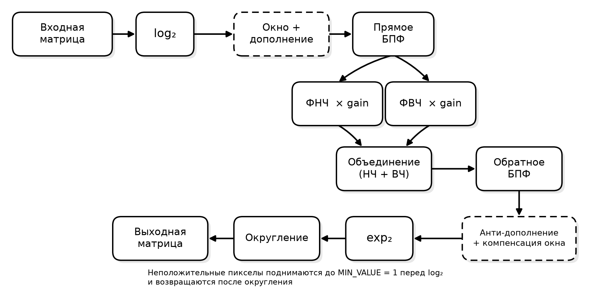
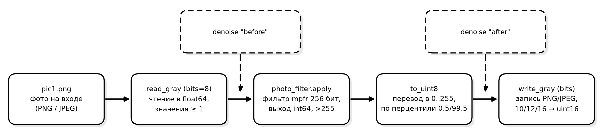
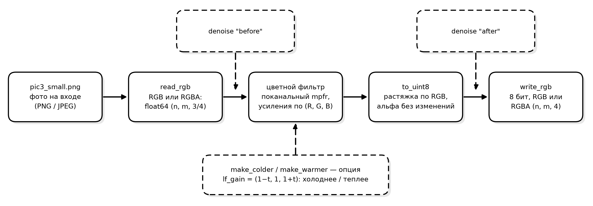
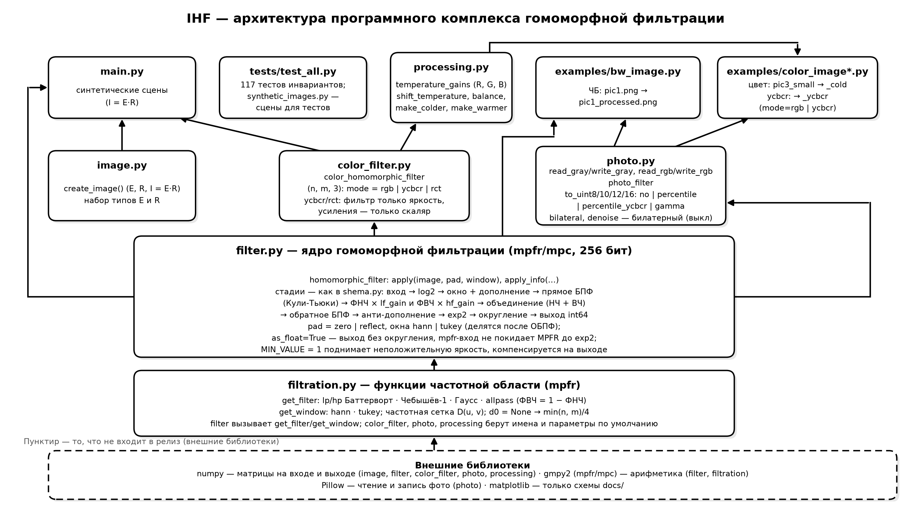

# IHF-IMAGE-HOMOMORPHIC-FILTER

**Русский** / [English](README_EN.md)

## Гомоморфная фильтрация изображений в арифметике произвольной точности

**Версия:** 0.95

**Базовая модель:** `I = E·R` → `log₂` → F → разделение спектра на НЧ и ВЧ → обработка частей → соединение → F^-1 → `exp₂` → округление.

**Реализовано:** базовая модель, обработка в оттенках серого и цветных фотографий
(поканально, по яркости BT.601 и обратимо по RCT), билатеральный
шумоподавляющий фильтр до и/или после гомоморфного, тесты и частично
документация.



## Установка

```bash
python -m venv .venv                  # Windows (PowerShell)
python3 -m venv .venv                 # Linux / macOS

.venv\Scripts\Activate.ps1            # активация: Windows (PowerShell)
source .venv/bin/activate             # активация: Linux / macOS

pip install -r requirements.txt
```

Команды запуска и тестов ниже предполагают активированное окружение
(в котором `python` работает на всех ОС). Подробности и системные
зависимости (`libgmp`, `libmpfr`, `libmpc`) — в [INSTALL.md](INSTALL.md).

Запуск:

```bash
python main.py                      # тесты фильтра
python examples/bw_image.py         # Фотография в оттенках серого
python examples/color_image_ycbcr.py # цветная фотография (по яркости)
python examples/color_image.py      # цветная фотография (по цвету)
```

## Использование

### Матрица синтетического изображения

```python
from image import create_image
from filter import homomorphic_filter

# E — освещённость (int 1..255), R — коэффициент отражения (float (R_MIN, 1]), I = E*R
e, r, i = create_image("const", "chess", 64, 64)

# Ослабление НЧ и усиление ВЧ
f = homomorphic_filter(lf_gain=0.5, hf_gain=2.0)
filtered = f.apply(i)
```

### Фотография в оттенках серого

```python
from photo import photo_filter, read_gray, write_gray

photo = read_gray("examples/pic1.png")               # float64 (n, m), значения > 0
f = photo_filter(lf_gain=0.75, hf_gain=2.0, d0=30.0) # pad="reflect" по умолчанию
write_gray("out.png", f.to_uint8(f.apply(photo)))
```

### Цветная фотография

Три режима обработки (`mode`):

| Режим | Что фильтруется | Особенности |
|---|---|---|
| `"rgb"` (по умолчанию) | каждый канал R, G, B независимо | единственный способ менять **цветовую температуру** (усиления по каналам) |
| `"ycbcr"` | только яркость `Y` (ITU-R BT.601) | `Cb/Cr` сохраняется **точно**; в MPFR; растяжка по яркости `output="percentile_ycbcr"` |
| `"rct"` | только псевдояркость `Y''` (ISO/IEC 21122) | **полностью обратим** (round-trip 0 LSB); веса яркости (0.25/0.50/0.25) отличаются от BT.601 |

#### Поканальный RGB

```python
from photo import photo_filter, read_rgb, write_rgb
from color_filter import color_homomorphic_filter

photo = read_rgb("examples/pic3_small.png")  # float64 (n, m, 3 или 4), RGB или RGBA

# Усиления можно задавать по каналам: скаляр или (R, G, B)
f = color_homomorphic_filter(lf_gain=(0.99, 1.0, 1.01), hf_gain=1.0, pad="reflect")
write_rgb("out.png", photo_filter.to_uint8(f.apply(photo)))
```

`lf_gain` по каналам меняет **освещённость** (цвет света), `hf_gain` —
**коэффициент отражения** (детали), согласно модели `I = E·R`:
в логарифмах низкие частоты — это `E`, высокие — `R`.  

«Холоднее» (colder): `(0.99, 1.0, 1.01)`.  

Каналы считаются последовательно или параллельно (пул из трёх процессов):

```python
f.apply(photo, parallel=True)    # только параллельно
f.apply(photo, parallel=False)   # только последовательно
f.apply(photo)                   # None — автоматически от 128×128 px на канал
```

Результаты **побитово совпадают**. По умолчанию выход считается быстрым
путём (`exp2` в float64 с точным mpfr fallback); `use_mpfr=True` держит
весь тракт канала в MPFR — тот же путь, что в `"ycbcr"`/`"rct"`.

#### Обработка по яркости: YCbCr и RCT

В этих режимах усиления обязаны быть **скалярами** (применяются к каналу
яркости).

```python
from photo import photo_filter, read_rgb, write_rgb
from color_filter import color_homomorphic_filter

photo = read_rgb("examples/pic3_small.png")

# BT.601: фильтруется Y, Cb/Cr сохраняются точно
f = color_homomorphic_filter(lf_gain=0.75, hf_gain=2.0, mode="ycbcr",
                             pad="reflect")
out = f.apply(photo)
write_rgb("out.png", photo_filter.to_uint8(out, output="percentile_ycbcr"))

# RCT: фильтруется Y'', Cr''/Cb'' сохраняются, преобразование обратимо точно
f = color_homomorphic_filter(lf_gain=0.75, hf_gain=2.0, mode="rct",
                             pad="reflect")
write_rgb("out.png", photo_filter.to_uint8(f.apply(photo),
                                           output="percentile_ycbcr"))
```

### Перевод в N бит (`to_uint8`, `to_uint10`, `to_uint12`, `to_uint16`)

Результат `apply` не ограничен диапазоном 0..255, поэтому перед записью нужен перевод:

| `Режим` | Что делает |
|---|---|
| `"percentile"` (по умолчанию) | линейная растяжка по перцентилям |
| `"percentile_ycbcr"` | растяжка по яркости Y (для режимов `"ycbcr"`/`"rct"`) |
| `"no"` | только обрезка к диапазону |
| `"gamma"` | гамма-коррекция после нормировки к [0, 1] |

Подробные параметры — в [docs/filter_recomend.md](docs/filter_recomend.md).
```python
photo_filter.to_uint8(filtered)                 # растяжка по перцентилям
photo_filter.to_uint8(filtered, output="no")    # сохранить значения как есть
photo_filter.to_uint8(filtered, output="gamma", gamma=1.8, low=0.5, high=99.5)
photo_filter.to_uint8(filtered, output="percentile_ycbcr")  # по яркости Y
```

Режимы вывода отличаются только верхней границей `0..2^bits-1`, формулы общие.
Неизвестный режим или параметр, не относящийся к выбранному режиму — `ValueError`
со списком доступных.

### Шумоподавление (билатеральный фильтр)

Используется билатеральный фильтр (Tomasi & Manduchi, 1998): вес соседа —
произведение гаусса по расстоянию (`sigma_space`) и гаусса по разности
яркостей (`sigma_range`). Считается в float64 — MPFR на этом шаге
избыточен. По умолчанию **выключено** (`DENOISE_DEFAULT = False`).

Подключить фильтр можно тремя способами.

**1. Отдельной функцией после вывода** — обрабатывается готовый кадр:

```python
from photo import photo_filter, denoise, read_gray, write_gray

out = photo_filter.to_uint8(filtered)
write_gray("out.png", denoise(out, True))                  # включено
write_gray("out.png", denoise(out, True, radius=3, sigma_range=25.0))
```

**2. Через `process()` — с выбором позиции относительно гомоморфного
фильтра:**

```python
from photo import photo_filter, read_gray, write_gray

photo = read_gray("examples/pic1.png")
f = photo_filter(lf_gain=0.75, hf_gain=2.0, d0=30.0,
                 denoise=True, filter_place="before")
write_gray("out.png", f.process(photo))                    # bits=8 по умолчанию
write_gray("out12.png", f.process(photo, bits=12))         # sigma_range масштабируется
```

`filter_place` принимает четыре значения:

| Позиция | Что делает |
|---|---|
| `"off"` | билатеральный фильтр не применяется |
| `"before"` | **до** гомоморфного фильтра, в шкале входа |
| `"after"` (по умолчанию) | **после** вывода, в шкале `0..2^bits−1` |
| `"before_and_after"` | с обеих сторон |

Позиция и флаг переопределяются на вызове:
`f.process(photo, denoise=True, filter_place="before")`.

**3. В цветных Y-режимах** — denoise доступен в `"ycbcr"` и `"rct"`,
где фильтруется одна яркость (в `"rgb"` — `ValueError`, так как
поканальная фильтрация разрушает границы, которые защищает билатеральный
вес):

```python
f = color_homomorphic_filter(lf_gain=0.75, hf_gain=2.0, mode="ycbcr",
                             denoise=True, filter_place="before",
                             denoise_radius=2, denoise_sigma_space=1.0,
                             denoise_sigma_range=15.0)
out = f.apply(photo)
write_rgb("out.png", photo_filter.to_uint8(out, output="percentile_ycbcr"))
```

**Параметры:** `radius` — полуразмер окна, кадр обрабатывается окном
`(2·radius+1)²`; `sigma_space` — в пикселах; `sigma_range` — в отсчётах
шкалы вывода (15 для 8 бит, ~3850 для 16).

### Отладка

`apply_info` печатает все стадии обработки построчно:

```python
homomorphic_filter("allpass", "allpass", 1.0, 0.0).apply_info(i)
```

## Фильтры, дополнение, окна

Типы фильтров (`filtration.py`): `lp_butterworth`/`hp_butterworth`,
`lp_chebyshev1`/`hp_chebyshev1`, `lp_gaussian`/`hp_gaussian`, `allpass`.
Пара ФНЧ/ФВЧ обязана быть согласованной: `HP = 1 − LP` одной семьи.

Детали: частота среза `d0`, порядок `order`, неравномерность АЧХ Чебышёва
`ripple_db`, методы дополнения (`pad="zero"|"reflect"`), окна (`hann`/`tukey`),
MIN_VALUE — в [docs/filter_recomend.md](docs/filter_recomend.md).

## Типы матриц

- **E** (освещённость): `const`, `sawtooth`, `triangular`,
  `exponential`, `slow_changes`
- **R** (коэффициент отражения): `chess`, `const`, `random`, `black_square`,
  `white_square`, `snowman`, `cat`
- **I** (интенсивность) получается из **E** и **R**: `I = E·R`

## Примеры

| Скрипт | Вход → выход | Что показывает |
|---|---|---|
| `examples/bw_image.py` | `pic1.png` → `pic1_processed.png` | фото в оттенках серого, `lf_gain=0.75`, `hf_gain=2.0`, растяжка по умолчанию |
| `examples/color_image.py` | `pic3_small.png` → `pic3_small_cold.png` | цвет, освещение холоднее: `lf_gain=(0.99, 1.0, 1.01)` |
| `examples/color_image_ycbcr.py` | `pic3_small.png` → `pic3_small_ycbcr.png` | цвет, только яркость Y (BT.601), растяжка `percentile_ycbcr` |

Схемы обработки (пунктирные врезки — опциональный denoise: до фильтра в
шкале входа или после вывода в шкале `0..2^bits−1`):





В `bw_image.py` и `color_image.py` он выключен (`DENOISE = False`),
в `color_image_ycbcr.py` — включён.

## Документация

Схемы в каталоге `docs/` генерируются из `docs/*.py`. Структура модулей
и зависимости:



## Тесты

```bash
python -m pytest tests/ -q          # тесты
python tests/test_all.py            # то же без pytest
```

Подробности — в [INSTALL.md](INSTALL.md).

Тесты проверяют инварианты модели `I = E·R`: прозрачность единичного
усиления, согласованность БПФ с наивным ДПФ, восстановление атрибутов из
кадра, корректность дополнения и окон, работу с фото. Синтетические сцены
для тестов — в `tests/synthetic_images.py`.

## Ссылки

1. Гонсалес Р. Цифровая обработка изображений / Р. Гонсалес, Р. Вудс. М.:
   Техносфера, 2012. 1104 с.
2. Cooley J.W. An Algorithm for the Machine Calculation of Complex Fourier
   Series / J.W. Cooley, J.W. Tukey // Mathematics of Computation. 1965,
   Vol. 19, No. 90. P. 297–301.
3. Stockham T.G. Image Processing in the Context of a Visual Model //
   Proceedings of the IEEE. 1972, Vol. 60, No. 7. P. 828–842.
4. IEEE Std 754-2019. IEEE Standard for Floating-Point Arithmetic.
   New York: IEEE, 2019. 84 p.
5. Homomorphic filter // GitHub. URL:
   https://github.com/glasgio/homomorphic-filter (дата обращения: 17.10.2026).
6. Андонов В.Г. Влияние резкости изображения на оптимальный градиент
   кривой тоновоспроизведения в кино и телевидении / В.Г. Андонов,
   М.В. Антипин, К.Ф. Гласман.
7. Красильников Н.Н. Цифровая обработка 2D- и 3D-изображений: учеб.
   пособие. СПб.: БХВ-Петербург, 2011. 608 с.
8. Сергиенко А.Б. Цифровая обработка сигналов: учеб. пособие. 3-е изд.
   СПб.: БХВ-Петербург, 2011. 756 с.
9. Oppenheim A.V. Nonlinear Filtering of Multiplied and Convolved Signals /
   A.V. Oppenheim, R.W. Schafer, T.G. Stockham // Proceedings of the IEEE.
   1968, Vol. 56, No. 8. P. 1264–1291.
10. Tomasi C. Bilateral Filtering for Gray and Color Images / C. Tomasi,
    R. Manduchi // Proceedings of the IEEE International Conference on
    Computer Vision. 1998. P. 839–846.

## Благодарности

Благодарю Константина Францевича Глассмана за консультации по гомоморфной
фильтрации и обработке изображений.
Благодарю glasgio за возможность использовать в качестве валидации результатов
https://github.com/glasgio/homomorphic-filter

## Лицензия

MIT

## Контакты

matmansky@yandex.ru (Владимир Яковлев)
