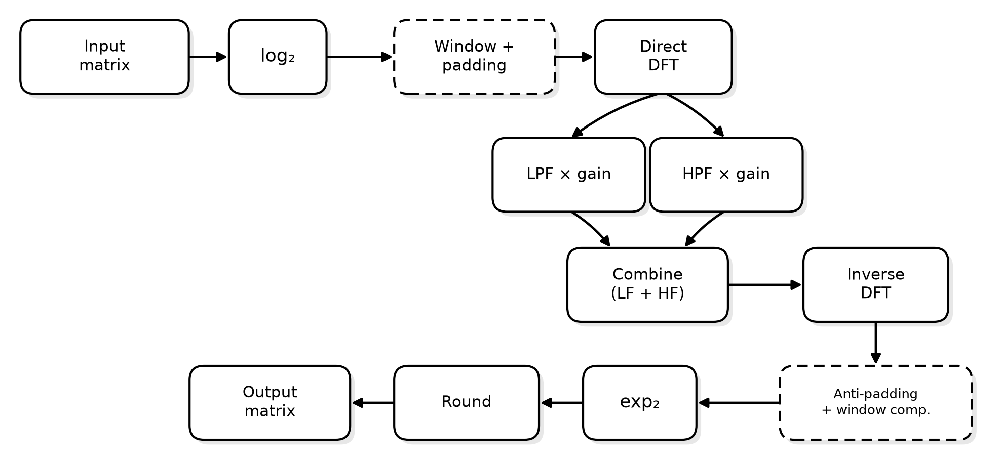
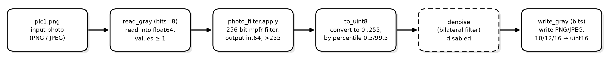
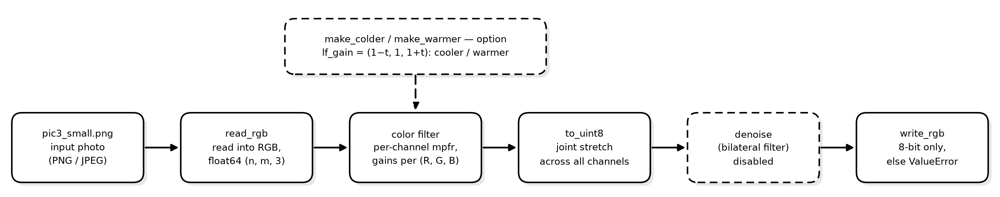
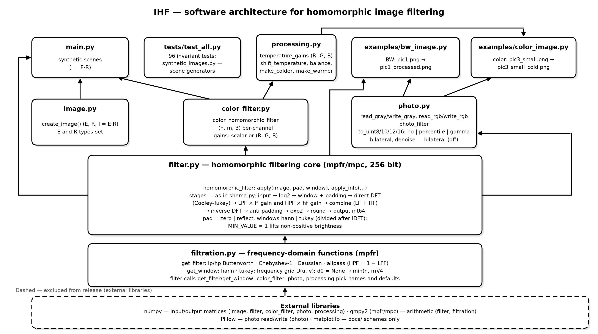

# IHF-IMAGE-HOMOMORPHIC-FILTER  

**English** / [Русский](README.md) 

## Homomorphic image filtering using arbitrary-precision arithmetic

**Version**: 0.80

**Model**: `I = E·R` → `log₂` → F → spectrum split into LF and HF components → per-component processing → recombination → F⁻¹ → `exp₂` → rounding.

**Implemented**: the basic pipeline, grayscale and color photo processing,
96 tests and partially documentation.



## Installation

```bash
python -m venv .venv && pip install -r requirements.txt
```

Details, virtual environment activation for Windows/Linux/macOS, and system
dependencies (`libgmp`, `libmpfr`, `libmpc`) — see [INSTALL.md](INSTALL.md).

## Running

```bash
python main.py                  # filter tests
python examples/bw_image.py     # Grayscale photo
python examples/color_image.py  # Color photo
```

## Usage

### Synthetic image matrix
```python
from image import create_image
from filter import homomorphic_filter

# E — illumination (int 1..255), R — reflectance (float (R_MIN, 1]), I = E·R
e, r, i = create_image("const", "chess", 64, 64)

# LF suppression, HF emphasis
f = homomorphic_filter(lf_gain=0.5, hf_gain=2.0)
filtered = f.apply(i)
```

### Grayscale photo
```python
from photo import photo_filter, read_gray, write_gray

photo = read_gray("examples/pic1.png")           # float64 (n, m), values > 0
f = photo_filter(lf_gain=0.75, hf_gain=2.0, d0=30.0)  # pad="reflect" by default
write_gray("out.png", f.to_uint8(f.apply(photo)))
```

### Color photo
Channels are processed independently.
```python
from photo import photo_filter, read_rgb, write_rgb
from color_filter import color_homomorphic_filter

photo = read_rgb("examples/pic3_small.png")  # float64 (n, m, 3), RGB; alpha is discarded

# Gains: scalar or one value per channel (R, G, B)
f = color_homomorphic_filter(lf_gain=(0.99, 1.0, 1.01), hf_gain=1.0, pad="reflect")
write_rgb("out.png", photo_filter.to_uint8(f.apply(photo)))
```

Per-channel `lf_gain` modulates illumination (the color of the light), while `hf_gain` modulates reflectance (fine detail), in accordance with the model `I = E·R`: in the logarithmic domain, low frequencies correspond to `E` and high frequencies to `R`.

"Cooler" tone: `(0.99, 1.0, 1.01)`.

### Conversion to N-bit integer (`to_uint8`, `to_uint10`, `to_uint12`, `to_uint16`)

The result of `apply` is not bounded to `0..255`, so conversion is required before saving:

| Output mode | What it does |
|---|---|
| `"percentile"` (default) | Linear stretch of percentiles to the upper bound |
| `"no"` | Clipping only (filter already performs rounding) |
| `"gamma"` | Gamma correction after normalization to `[0, 1]` |

Full parameter details — see [docs/filter_recomend.md](docs/filter_recomend.md).

```python
photo_filter.to_uint8(filtered)                                    # percentile stretch
photo_filter.to_uint8(filtered, output="no")                       # keep values as-is
photo_filter.to_uint8(filtered, output="gamma", gamma=1.8, low=0.5, high=99.5)
```

Output modes differ only in the upper bound `0..2^bits-1`; the formulas are shared. An unknown mode, or a parameter belonging to another mode, raises `ValueError` with a list of available options.

For a color frame, percentiles are computed jointly across all channels.

### Denoising (`denoise`, disabled by default)
A bilateral filter is used:
```python
from photo import photo_filter, denoise, read_gray, write_gray

out = photo_filter.to_uint8(filtered)
write_gray("out.png", denoise(out, True))                          # enabled
write_gray("out.png", denoise(out, True, radius=3, sigma_range=25.0))
```
`enabled` defaults to `DENOISE_DEFAULT = False` — the frame is returned unchanged.
Denoising is computed in `float64`; MPFR precision is redundant at this stage.

### Debugging
`apply_info` prints every pipeline stage line by line:
```python
homomorphic_filter("allpass", "allpass", 1.0, 0.0).apply_info(i)
```

## Filters, Padding, Windows

Filter types (`filtration.py`): `lp_butterworth`/`hp_butterworth`,
`lp_chebyshev1`/`hp_chebyshev1`, `lp_gaussian`/`hp_gaussian`, `allpass`.
The LPF/HPF pair must be consistent: `HP = 1 − LP` from the same family.

Details: cutoff frequency `d0`, order `order`, Chebyshev passband ripple
`ripple_db`, padding methods (`pad="zero"|"reflect"`), windows (`hann`/`tukey`),
MIN_VALUE — see [docs/filter_recomend.md](docs/filter_recomend.md).

## Matrix Types
- `E` (illumination): `const`, `sawtooth`, `triangular`, `exponential`, `slow_changes`
- `R` (reflectance): `chess`, `const`, `random`, `black_square`, `white_square`, `snowman`, `cat`
- `I` (intensity) is obtained from `E` and `R` as `I = E·R`

## Examples

| Script | Input → Output | What it demonstrates |
| --- | --- | --- |
| `examples/bw_image.py` | `pic1.png` → `pic1_processed.png` | Grayscale photo, `lf_gain=0.75`, `hf_gain=2.0`, default stretch |
| `examples/color_image.py` | `pic3_small.png` → `pic3_small_cold.png` | Color, cooler illumination: `lf_gain=(0.99, 1.0, 1.01)` |

Grayscale photo processing pipeline:



Color photo processing pipeline:



Both examples contain a `DENOISE = False` flag controlling post-filter denoising of the resulting frame.

## Documentation

### Schematics

Schematics in the `docs/` directory are generated from `docs/*.py`. To rebuild:

```bash
python docs/shema.py                 # RU version
python docs/shema.py --en            # + EN version
python docs/photo_shema.py           # RU versions (BW + color)
python docs/photo_shema.py --en      # + EN versions
python docs/architecture.py          # RU version
python docs/architecture.py --en     # + EN version
```

Module structure and dependencies:



Complete documentation for parameter configuration is still in development [docs/filter_recomend.md](docs/filter_recomend.md).

## Tests

```bash
python -m pytest tests/ -q          # 96 tests
python tests/test_all.py            # same without pytest
```

Details — see [INSTALL.md](INSTALL.md).

Tests verify the invariants of the `I = E·R` model: unity-gain transparency,
FFT-to-DFT consistency, attribute recovery from frames, correctness of padding
and windows, and photo processing. Synthetic test scenes are in
`tests/synthetic_images.py`.

## References

References are given in their original language.

1. Гонсалес Р. Цифровая обработка изображений / Р. Гонсалес, Р. Вудс. М.:
   Техносфера, 2012. 1104 с;
2. Cooley J.W. An Algorithm for the Machine Calculation of Complex Fourier
   Series / J.W. Cooley, J.W. Tukey // Mathematics of Computation. 1965,
   Vol. 19, No. 90. P. 297–301.
3. Stockham T.G. Image Processing in the Context of a Visual Model //
   Proceedings of the IEEE. 1972, Vol. 60, No. 7. P. 828–842.
4. IEEE Std 754-2019. IEEE Standard for Floating-Point Arithmetic.
   New York: IEEE, 2019. 84 p.
5. Homomorphic filter // GitHub. URL:
   https://github.com/glasgio/homomorphic-filter (accessed: 17.10.2026).
6. Андонов В.Г. Влияние резкости изображения на оптимальный градиент
   кривой тоновоспроизведения в кино и телевидении / В.Г. Андонов,
   М.В. Антипин, К.Ф. Гласман.
7. Красильников Н.Н. Цифровая обработка 2D- и 3D-изображений: учеб.
   пособие. СПб.: БХВ-Петербург, 2011. 608 с.
8. Сергиенко А.Б. Цифровая обработка сигналов: учеб. пособие. 3-е изд.
   СПб.: БХВ-Петербург, 2011. 756 с.
9. Oppenheim A.V. Nonlinear Filtering of Multiplied and Convolved Signals /
   A.V. Oppenheim, R.W. Schafer, T.G. Stockham // Proceedings of the IEEE.
   1968, Vol. 56, No. 8. P. 1264–1291.

## Acknowledgments
I thank Konstantin Frantsevich Glassman for consultations on homomorphic filtering and image processing.
I thank glasgio for providing https://github.com/glasgio/homomorphic-filter as a validation reference.

## License
MIT

## Contact
matmansky@yandex.ru (Vladimir Yakovlev)